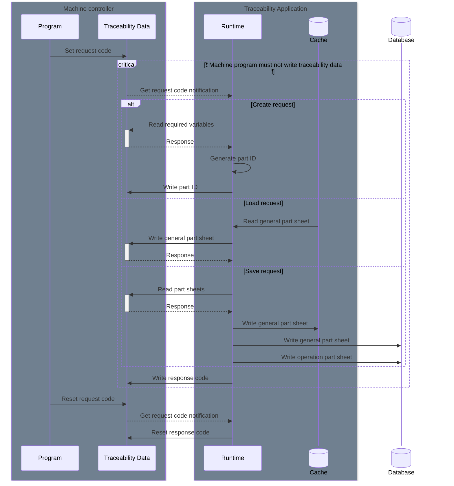

# OPC-UA Line Gateway

Gateway for machines of an industrial production line, using OPC-UA to connect to
PLCs, with data caching and archiving.

## How it works

This project provides executable services, intended to run forever. The service
connects to the PLCs of the machines to allow them to request data save or retrieval.
The data is kept in a disk-backed memory cache to allow efficient storage and fetching.

### OPC-UA

The service acts as multiple OPC-UA clients, each one connected to an OPC-UA server
on a machine (PLC). Upon disconnection from the machine, the client tries to reconnect
forever.

### Configuration

The application binary expects the path to a TOML configuration file as its first
command line argument.

The configuration structure is described in this [documentation](docs/configuration.md).

### Credentials

Credentials (ClickHouse and OPC-UA servers usernames and passwords) are kept out
of the configuration file. They are read from a `credentials.toml` file, in the
directory pointed to by the `CREDENTIALS_DIRECTORY` environment variable, which
is set by [systemd credentials](https://systemd.io/CREDENTIALS/) or a similar
mechanism:

```toml
[database]
user = "…"
password = "…"

# Keys are the machines identifiers of the configuration file.
[opc_ua.machine1]
user = "…"
password = "…"
```

The database credential is required. Machines without an entry in the `opc_ua`
table use anonymous authentication.

## Systemd service

The service and user setup is handled by the Debian package, for a single gateway
instance per host.

### Configuration

The service only starts once both `/etc/opcua-line-gateway/config.toml` and
`/etc/credstore/opcua-line-gateway.toml` exist. Commented examples of these
files are shipped in `/usr/share/doc/opcua-line-gateway/examples`, to be copied
and adapted:

```sh
examples=/usr/share/doc/opcua-line-gateway/examples
sudo install -d /etc/opcua-line-gateway
sudo install -m 0644 "$examples/config.toml" /etc/opcua-line-gateway/
sudo install -m 0600 "$examples/credentials.toml" /etc/credstore/opcua-line-gateway.toml
sudoedit /etc/opcua-line-gateway/config.toml /etc/credstore/opcua-line-gateway.toml
sudo systemctl start opcua-line-gateway
```

The unit passes `/etc/opcua-line-gateway/config.toml` as the first positional
argument. Paths inside it may be relative, in which case they resolve against
`/var/lib/opcua-line-gateway` (the unit's working directory).

The unit loads the credentials file as a systemd credential, from the systemd
credential store: `/etc/credstore` is only accessible by root, so the secrets
are protected whatever the file mode. Systemd reads the file when the service
starts, so restart it after changing credentials.

The OPC-UA certificate and private key are expected at
`pki_dir/own/opcua-line-gateway-cert.der` and
`pki_dir/private/opcua-line-gateway-key.pem`. Servers' certificates to trust go
into `pki_dir/trusted`.

### Operation

Logs are written in files in `/var/log/opcua-line-gateway/` directory, rotated and
compressed daily.

Log verbosity is set by `RUST_LOG` in the unit (`info` by default); override it
with `sudo systemctl edit opcua-line-gateway` rather than by editing the
installed unit.

### Visualization

A Grafana dashboard displays the archived part sheets, see the
[setup documentation](docs/grafana.md).

## Traceability

This service handles traceability management, which involves moving data between,
on one side, OPC-UA servers it connects to, and on the other side, an in-memory
disk-persisted cache and a ClickHouse database.

The data consists of groups of OPC-UA variables, which can be scalars or arrays
of scalars. Grouping is achieved by organizing variables in a group as properties
of an OPC-UA object. In this project's terminology, some groups are called
"part sheets".

OPC-UA server data is organised in three groups:

* The "traceability protocol" group, which includes the request code, the response
code, and the OPC-UA client heartbeat;
* The "general part sheet" group, which includes data that is common to all OPC-UA
servers;
* The "operation part sheet" group, which includes data that is specific for each
operation on the production line.

### Protocol



#### Request code at connection

Each time the gateway connects to a machine, at startup or after a connection
loss, the first request code it gets from each mailbox is the current value of
the variable, which may have been set while the gateway was not connected. As it
cannot tell whether such a request has already been handled, the gateway does
not handle it:

* A reset request code (`0`) resets the response code, as usual;
* Any other request code is refused with the `93` response code, without
  reading or writing any traceability data.

After a `93` response code, the machine program must reset the request code,
wait for the response code to be reset, then set the request code again, if the
request is still needed.

A request answered just before a connection loss, whose request code was not
reset yet when the gateway reconnects, also gets its response code overwritten
with `93`, although it succeeded. The machine program should therefore act on a
response code as soon as it gets it.
