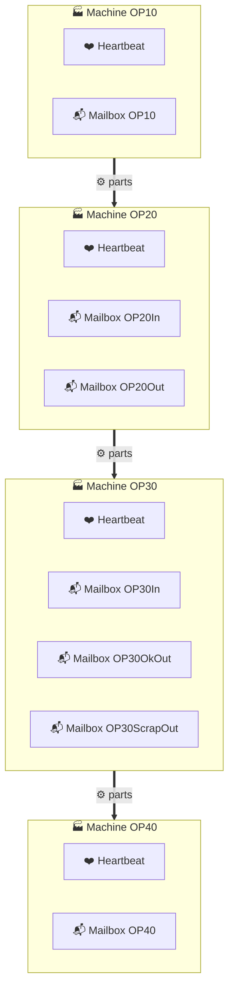
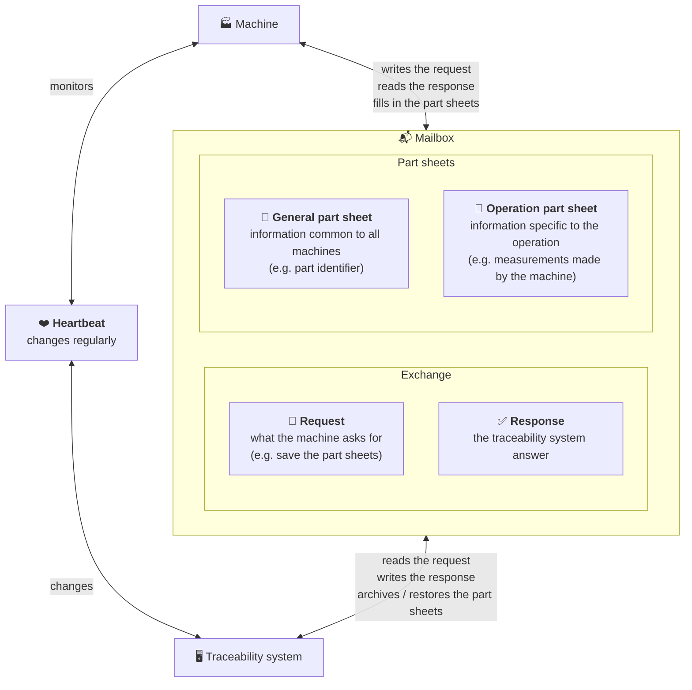
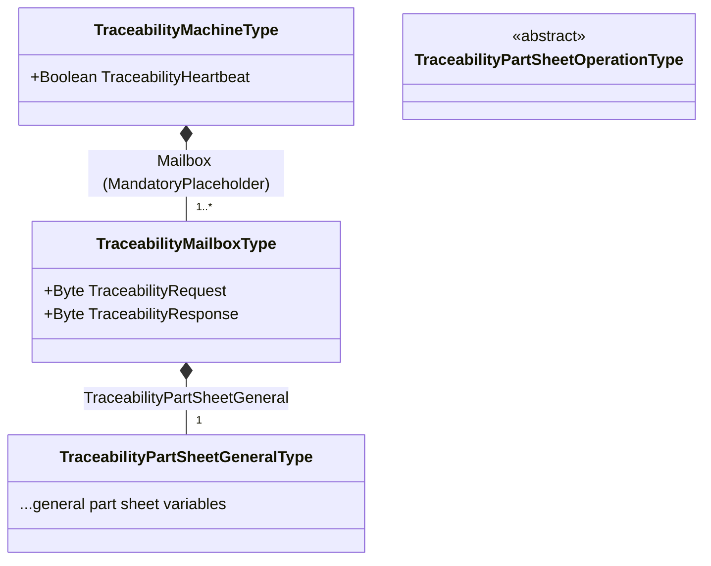
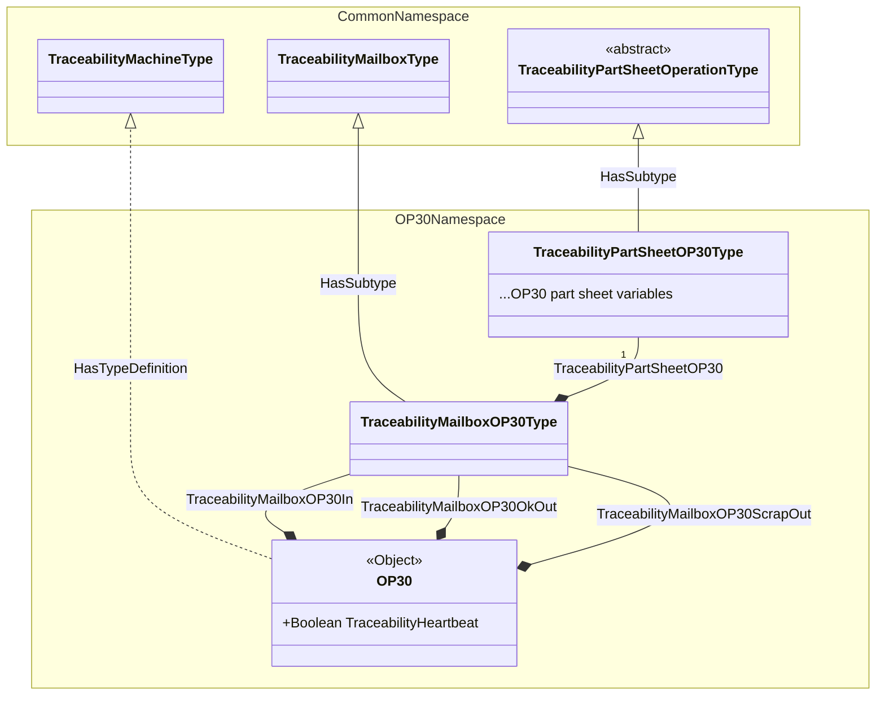

# Target OPC-UA information model

> [!NOTE]
> This model is not implemented yet, see the [TO-DO list](../TODO.md). The
> [README](../README.md) describes the model currently handled.

## Overview

Each machine exposes a heartbeat and one or more mailboxes. A mailbox holds the
traceability protocol variables (request and response codes) and a complete set
of part sheets: the general part sheet and the operation part sheet.

### Example for a production line

* Machine OP10
  * TraceabilityHeartbeat (boolean)
  * TraceabilityMailboxOP10 (object)
    * TraceabilityRequest (byte)
    * TraceabilityResponse (byte)
    * TraceabilityPartSheetGeneral (object)
      * ...general part sheet variables (mixed variable types)
    * TraceabilityPartSheetOP10
      * ...OP10 part sheet variables (mixed variable types)
* Machine OP20
  * TraceabilityHeartbeat (boolean)
  * TraceabilityMailboxOP20In (object)
    * TraceabilityRequest (byte)
    * TraceabilityResponse (byte)
    * TraceabilityPartSheetGeneral (object)
      * ...general part sheet variables (mixed variable types)
    * TraceabilityPartSheetOP20
      * ...OP20 part sheet variables (mixed variable types)
  * TraceabilityMailboxOP20Out (object)
    * TraceabilityRequest (byte)
    * TraceabilityResponse (byte)
    * TraceabilityPartSheetGeneral (object)
      * ...general part sheet variables (mixed variable types)
    * TraceabilityPartSheetOP20
      * ...OP20 part sheet variables (mixed variable types)
* Machine OP30
  * TraceabilityHeartbeat (boolean)
  * TraceabilityMailboxOP30In (object)
    * TraceabilityRequest (byte)
    * TraceabilityResponse (byte)
    * TraceabilityPartSheetGeneral (object)
      * ...general part sheet variables (mixed variable types)
    * TraceabilityPartSheetOP30
      * ...OP30 part sheet variables (mixed variable types)
  * TraceabilityMailboxOP30OkOut (object)
    * TraceabilityRequest (byte)
    * TraceabilityResponse (byte)
    * TraceabilityPartSheetGeneral (object)
      * ...general part sheet variables (mixed variable types)
    * TraceabilityPartSheetOP30
      * ...OP30 part sheet variables (mixed variable types)
  * TraceabilityMailboxOP30ScrapOut (object)
    * TraceabilityRequest (byte)
    * TraceabilityResponse (byte)
    * TraceabilityPartSheetGeneral (object)
      * ...general part sheet variables (mixed variable types)
    * TraceabilityPartSheetOP30
      * ...OP30 part sheet variables (mixed variable types)
* Machine OP40
  * TraceabilityHeartbeat (boolean)
  * TraceabilityMailboxOP40 (object)
    * TraceabilityRequest (byte)
    * TraceabilityResponse (byte)
    * TraceabilityPartSheetGeneral (object)
      * ...general part sheet variables (mixed variable types)
    * TraceabilityPartSheetOP40
      * ...OP40 part sheet variables (mixed variable types)

### Simplified view

Each machine of the line has one or more mailboxes to exchange part information
with the traceability system. Their number is chosen by the machine builder, and
is not necessarily related to the flow of parts: a machine can use a single
mailbox and perform data transfers internally at the right times, or use several
mailboxes, for instance one for each point where parts enter or leave it. Each
machine also has a heartbeat, showing that the traceability system is connected
and working:

All mailboxes are organized the same way: a request and a response, to exchange
with the traceability system, and two forms describing the part, the part
sheets. The traceability system archives the part sheets, and can restore the
general part sheet on a machine further down the line. Next to the mailboxes,
the traceability system regularly changes the heartbeat, which the machine
monitors to know that the traceability system is connected and working:

## Namespaces

The model is split in companion specifications, imported in the machines
controllers:

* A common namespace, imported on all machines, which only defines types:
  * `TraceabilityMachineType`, with the heartbeat and a `<Mailbox>` component of
  `TraceabilityMailboxType`, with the `MandatoryPlaceholder` modelling rule (i.e.
  one or more mailboxes, with any name);
  * `TraceabilityMailboxType`, with the request, the response and the general part
  sheet;
  * `TraceabilityPartSheetGeneralType`;
  * `TraceabilityPartSheetOperationType`, abstract base of operation part
  sheets.
* An operation namespace for each operation, imported on the machine performing
it, which defines:
  * the operation part sheet type, subtype of
  `TraceabilityPartSheetOperationType`;
  * the mailbox type, subtype of `TraceabilityMailboxType` adding the operation
  part sheet;
  * the machine instance, with its mailboxes.

### Diagrams

Types of the common namespace:

Example of the OP30 operation namespace (names of operation-specific types are
illustrative), with the common namespace types it relies on:

Legend: links with a filled diamond are `HasComponent` references (labelled with
the BrowseName of the child, the diamond being on the parent side), links with a
hollow triangle are `HasSubtype` references (the triangle pointing to the
supertype), dashed links are `HasTypeDefinition` references.

## Nodes resolution

Node identifiers of the general part sheet differ between mailboxes and machines,
so they are not used as references. Instead:

* Mailboxes are discovered by browsing the machine object, and the operation part
sheet is found by its type;
* At session initialization, a `BrowseName → NodeId` table is built for each mailbox,
then OPC-UA reads and writes keep using numeric node identifiers;
* Cached general part sheet items are keyed by BrowseName (name part only), which
is identical on all machines as defined by the common namespace types.
