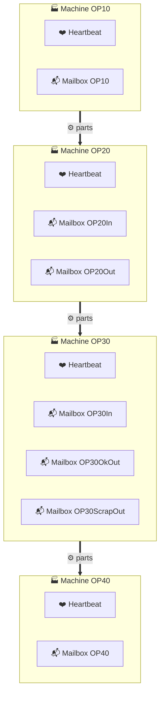
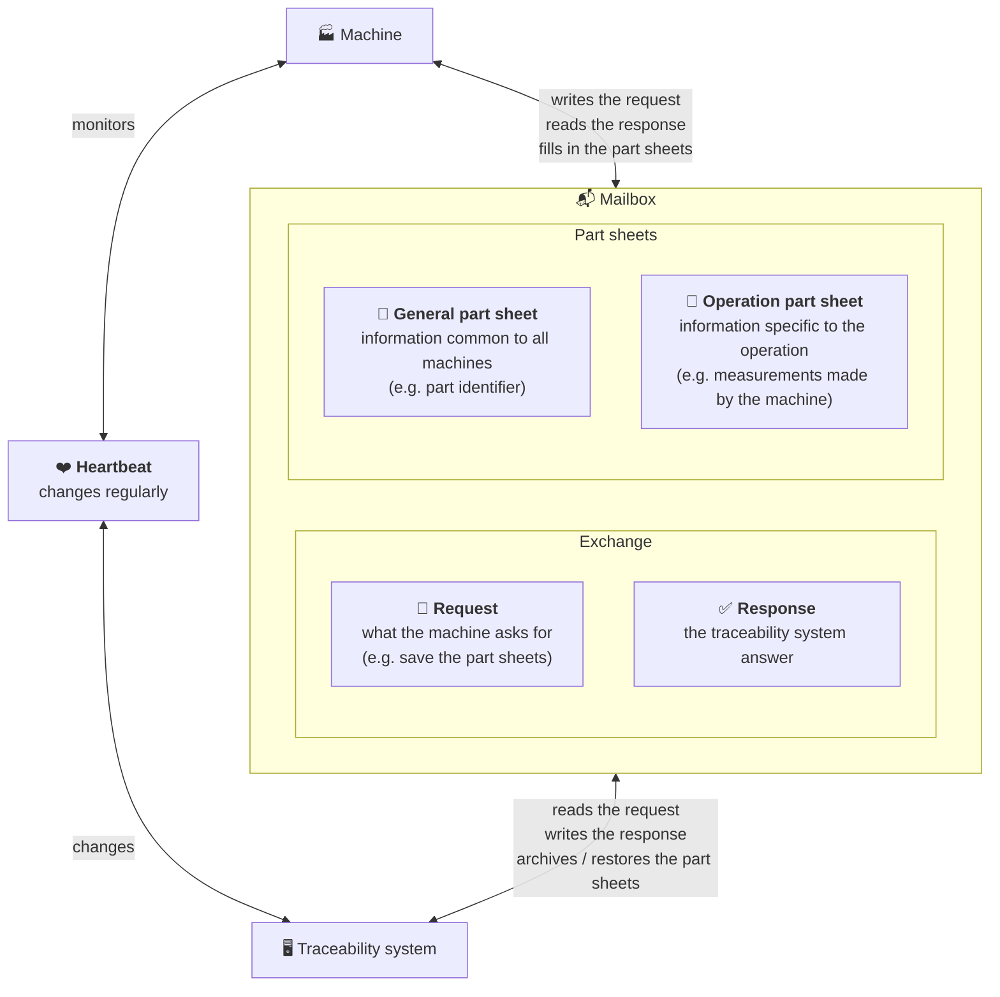
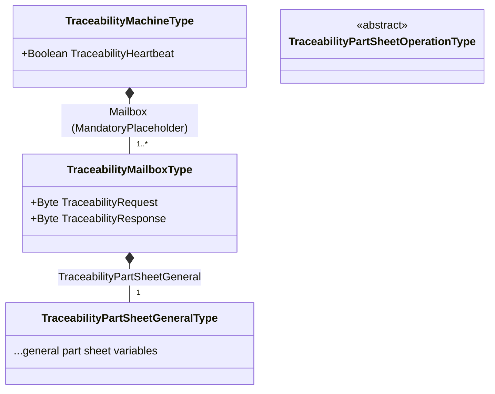
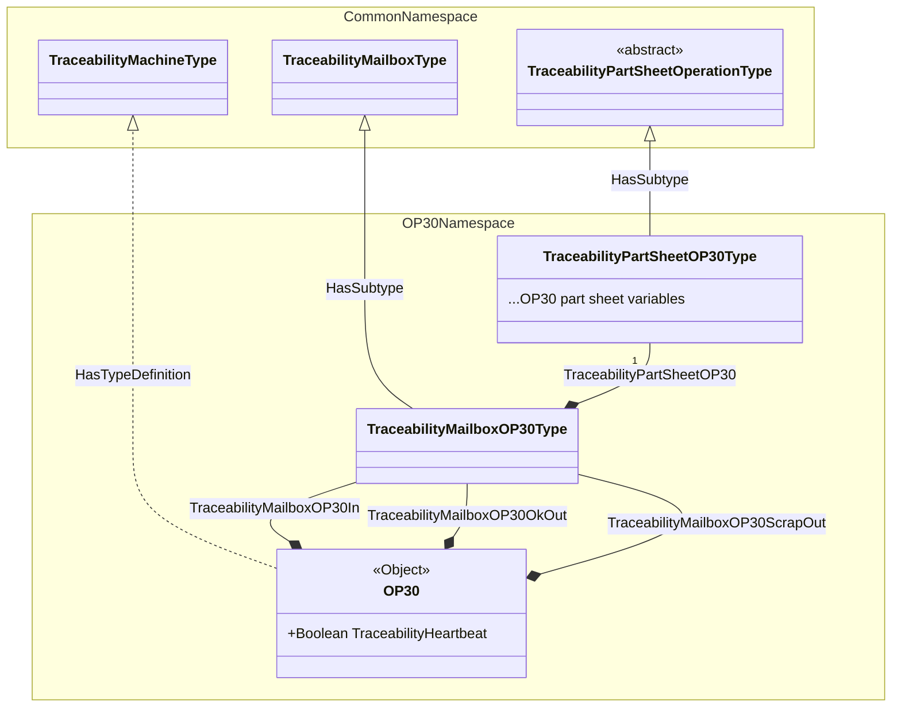

# Target OPC-UA information model

> [!NOTE]
> This model is not implemented yet, see the [TO-DO list](../TODO.md). The
> [README](../README.md) describes the model currently handled.

## Overview

Each machine exposes a heartbeat and one or more mailboxes. A mailbox holds the
traceability protocol variables (request and response codes) and a complete set
of part sheets: the general part sheet and the operation part sheet.

### Example for a production line

* Machine OP10
  * TraceabilityHeartbeat (boolean)
  * TraceabilityMailboxOP10 (object)
    * TraceabilityRequest (byte)
    * TraceabilityResponse (byte)
    * TraceabilityPartSheetGeneral (object)
      * ...general part sheet variables (mixed variable types)
    * TraceabilityPartSheetOP10
      * ...OP10 part sheet variables (mixed variable types)
* Machine OP20
  * TraceabilityHeartbeat (boolean)
  * TraceabilityMailboxOP20In (object)
    * TraceabilityRequest (byte)
    * TraceabilityResponse (byte)
    * TraceabilityPartSheetGeneral (object)
      * ...general part sheet variables (mixed variable types)
    * TraceabilityPartSheetOP20
      * ...OP20 part sheet variables (mixed variable types)
  * TraceabilityMailboxOP20Out (object)
    * TraceabilityRequest (byte)
    * TraceabilityResponse (byte)
    * TraceabilityPartSheetGeneral (object)
      * ...general part sheet variables (mixed variable types)
    * TraceabilityPartSheetOP20
      * ...OP20 part sheet variables (mixed variable types)
* Machine OP30
  * TraceabilityHeartbeat (boolean)
  * TraceabilityMailboxOP30In (object)
    * TraceabilityRequest (byte)
    * TraceabilityResponse (byte)
    * TraceabilityPartSheetGeneral (object)
      * ...general part sheet variables (mixed variable types)
    * TraceabilityPartSheetOP30
      * ...OP30 part sheet variables (mixed variable types)
  * TraceabilityMailboxOP30OkOut (object)
    * TraceabilityRequest (byte)
    * TraceabilityResponse (byte)
    * TraceabilityPartSheetGeneral (object)
      * ...general part sheet variables (mixed variable types)
    * TraceabilityPartSheetOP30
      * ...OP30 part sheet variables (mixed variable types)
  * TraceabilityMailboxOP30ScrapOut (object)
    * TraceabilityRequest (byte)
    * TraceabilityResponse (byte)
    * TraceabilityPartSheetGeneral (object)
      * ...general part sheet variables (mixed variable types)
    * TraceabilityPartSheetOP30
      * ...OP30 part sheet variables (mixed variable types)
* Machine OP40
  * TraceabilityHeartbeat (boolean)
  * TraceabilityMailboxOP40 (object)
    * TraceabilityRequest (byte)
    * TraceabilityResponse (byte)
    * TraceabilityPartSheetGeneral (object)
      * ...general part sheet variables (mixed variable types)
    * TraceabilityPartSheetOP40
      * ...OP40 part sheet variables (mixed variable types)

### Simplified view

Each machine of the line has one or more mailboxes to exchange part information
with the traceability system. Their number is chosen by the machine builder, and
is not necessarily related to the flow of parts: a machine can use a single
mailbox and perform data transfers internally at the right times, or use several
mailboxes, for instance one for each point where parts enter or leave it. Each
machine also has a heartbeat, showing that the traceability system is connected
and working:

All mailboxes are organized the same way: a request and a response, to exchange
with the traceability system, and two forms describing the part, the part
sheets. The traceability system archives the part sheets, and can restore the
general part sheet on a machine further down the line. Next to the mailboxes,
the traceability system regularly changes the heartbeat, which the machine
monitors to know that the traceability system is connected and working:

## Namespaces

The model is split in companion specifications, imported in the machines
controllers:

* A common namespace, imported on all machines, which only defines types (it has
no instances):
  * `TraceabilityPartSheetGeneralType`, with the general part sheet variables;
  * `TraceabilityPartSheetOperationType`, abstract and without variables, base of
  the operation part sheets types;
  * `TraceabilityMailboxType`, with:
    * `TraceabilityRequest` (`Byte`, read only);
    * `TraceabilityResponse` (`Byte`, read and write);
    * `TraceabilityPartSheetGeneral`, a mandatory component of
    `TraceabilityPartSheetGeneralType`;
  * `TraceabilityMachineType`, with:
    * `TraceabilityHeartbeat` (`Boolean`, read and write);
    * a `<Mailbox>` component of `TraceabilityMailboxType`, with the
    `MandatoryPlaceholder` modelling rule (i.e. one or more mailboxes, with any
    name).
* An operation namespace for each operation, imported on the machine performing
it, which defines (e.g. for OP30):
  * the operation part sheet type (`TraceabilityPartSheetOP30Type`), subtype of
  `TraceabilityPartSheetOperationType`, with the operation part sheet variables;
  * the mailbox type (`TraceabilityMailboxOP30Type`), subtype of
  `TraceabilityMailboxType`, adding the operation part sheet as a component
  (`TraceabilityPartSheetOP30`);
  * the machine instance (`OP30`), of `TraceabilityMachineType`, organized in the
  `Objects` folder, with its mailboxes as components of the operation mailbox type
  (e.g. `TraceabilityMailboxOP30In`).

The instances of the operation namespaces result in the tree shown in the
[example](#example-for-a-production-line).

All the variables of the model (heartbeat, request, response and part sheets
variables) are data variables, i.e. components (`HasComponent` references) of
`BaseDataVariableType`, rather than properties, as they hold the contents of their
parent object and not characteristics of it. The part sheets have no properties.

### Diagrams

Types of the common namespace:

Example of the OP30 operation namespace (names of operation-specific types are
illustrative), with the common namespace types it relies on:

Legend: links with a filled diamond are `HasComponent` references (labelled with
the BrowseName of the child, the diamond being on the parent side), links with a
hollow triangle are `HasSubtype` references (the triangle pointing to the
supertype), dashed links are `HasTypeDefinition` references.

## Design rationale

### Import in the machines controllers

* A controller (e.g. S7-1500 with TIA Portal) imports a companion specification
as a whole, and the variables of its instances are mapped to the controller
variables. As each machine only imports the common namespace and the namespace
of its operation, it has no instances of other machines to map.
* Controllers can only map the variables of existing instances, they do not
instantiate types. Instances are thus fully expanded in the operation namespaces
nodesets, with all their children.
* When several machines perform the same operation:
  * if they are identical (same object name, same mailboxes), the same operation
  namespace is imported on each of them, each OPC-UA server exposing its own
  instance;
  * otherwise, the operation namespace only defines the types, and each machine
  has an additional namespace, depending on it, which defines its instance. The
  types must not be duplicated in each machine namespace, as types from
  different namespaces are different types.

### BrowseNames

* The children of an instance take the BrowseNames of the type children they are
created from, including the namespace of the type defining them. The request, the
response, the general part sheet and its variables thus have BrowseNames in the
common namespace, identical on all machines, whatever the namespace of the
machine instance. This is what allows resolving nodes by BrowseName.
* The operation part sheet is found by its type rather than by its BrowseName,
which can then be specific to each operation (e.g. `TraceabilityPartSheetOP30`).

### Node identifiers stability

Node identifiers are assigned when generating the nodesets. The generator keeps
the identifiers of the previous generation, so that adding a variable does not
renumber the other nodes: the mappings of the controllers variables remain valid
when importing an updated nodeset. The gateway does not depend on these
identifiers anyway (see below).

## Nodes resolution

Node identifiers of the general part sheet differ between mailboxes and machines,
so they are not used as references. Instead:

* All the nodes of a machine are discovered by browsing recursively the machine
object, following `HasComponent` references: the results hold, for each node
found, its BrowseName, its node class and its type definition;
* Nodes with BrowseNames defined by the common namespace types (the heartbeat in
the machine object, the request, the response and the general part sheet in each
mailbox) are identified by their BrowseName. A missing node gives a specific
error, naming the parent node and the expected BrowseName, revealing an
unexpected model;
* Mailboxes and operation part sheets are identified by their type, as their
BrowseNames are not known beforehand;
* The variables of the part sheets are all the variables found below the part
sheets objects, as all of them are needed;
* At session initialization, a `BrowseName → NodeId` table is built for each mailbox,
then OPC-UA reads and writes keep using numeric node identifiers;
* Cached general part sheet items are keyed by BrowseName (name part only), which
is identical on all machines as defined by the common namespace types.

Summary of how each kind of node is identified in the browse results:

| Nodes to find | BrowseName known beforehand | Identified by |
| --- | --- | --- |
| Heartbeat of a machine | Yes, in the common namespace | BrowseName |
| Mailboxes of a machine | No (`<Mailbox>` placeholder) | Type definition |
| Request, response and general part sheet of a mailbox | Yes, in the common namespace | BrowseName |
| Operation part sheet of a mailbox | No (specific to each operation) | Type definition |
| Variables of the part sheets | All of them are needed, not a fixed list | Node class (`Variable`) |

The `TranslateBrowsePathsToNodeIds` service is not used: it would only resolve
the nodes with BrowseNames known beforehand, in an additional request, and its
results only hold node identifiers, without BrowseNames nor types. Browsing
already returns all of them.

### Resolution sequence

The `Browse` service only returns the references of the nodes it is given, one
level at a time. The recursion is done by the client, with the `Browser` of
`async-opcua`: at each level, it browses all the nodes given by its policy for the
results of the previous level in a single request, and handles the continuation
points (`BrowseNext`).

The policy is a closure, called for each result, returning the nodes to browse
next. For each object found (node of `Object` class), it returns two browse
descriptions:

* the object itself, following its `HasComponent` references forward (subtypes
included), to nodes of `Object` and `Variable` classes, to find its components;
* its type definition, following its `HasSubtype` references inverse (displayed
as `SubtypeOf` by clients), to find its direct supertype (see
[Types check](#types-check)).

The policy returns nothing for the results of a type (inverse browse), and for the
results of the part sheets (their variables, at the third level), which ends the
recursion. The browser never browses a node twice in the same direction, so a type
shared by several objects (e.g. the type of all the mailboxes of a machine) is
only browsed once.

The types being browsed together with the components of the objects of the same
level, the nodes of a machine are resolved with three requests, whatever the
number of mailboxes:

1. `Browse` of the machine object: heartbeat and mailboxes;
2. `Browse` of all the mailboxes, and of the types of the objects of the machine
object: request, response, general part sheet and operation part sheet of each
mailbox, and the supertypes;
3. `Browse` of all the part sheets, and of their types: the variables of the part
sheets, and the supertypes.

For example, with the three mailboxes of OP30:

| # | Nodes browsed | Nodes found |
| --- | --- | --- |
| 1 | `OP30` | `TraceabilityHeartbeat`, `TraceabilityMailboxOP30In`, `TraceabilityMailboxOP30OkOut`, `TraceabilityMailboxOP30ScrapOut` |
| 2 | The three mailboxes, `TraceabilityMailboxOP30Type` | For each mailbox: `TraceabilityRequest`, `TraceabilityResponse`, `TraceabilityPartSheetGeneral`, `TraceabilityPartSheetOP30`; the supertype `TraceabilityMailboxType` |
| 3 | The six part sheets, `TraceabilityPartSheetGeneralType`, `TraceabilityPartSheetOP30Type` | The variables of the part sheets; the supertypes `BaseObjectType` and `TraceabilityPartSheetOperationType` |

The browser returns a stream of results, one for each node browsed, holding its
references with their description (BrowseName, node class and type definition).
The gateway collects them in two tables, depending on the browse direction of the
result: the children of each object (forward browse), and the supertype of each
type (inverse browse). The tables are used once the whole stream is consumed, as
the results come in any order. Each mailbox is then initialized in its own
routine, from its part of these tables, without sending any request itself.

The results are walked down from the machine object, following the references
from each node to its children:

1. The children of the machine object whose type derives from
`TraceabilityMailboxType` are the mailboxes, each one given to its own
initialization routine;
2. The children of a mailbox are its request, response and general part sheet
(identified by BrowseName), and its operation part sheet (identified by its type,
deriving from `TraceabilityPartSheetOperationType`);
3. The children of a part sheet are its variables.

Walking down from each mailbox, the nodes found always belong to it, without
having to match them afterwards. The entries of the children table can be removed
as they are used, so that their contents are moved into the mailboxes rather than
copied. No filtering on the reference type is needed: the browser only followed
`HasComponent` references, so the children recorded are only components. As
instances are fully expanded in the nodesets, each mailbox has its own nodes, with
distinct node identifiers, so a part sheet variable has a single parent.

### Types check

The type definition of a node found is its concrete type, from the operation
namespace (e.g. `TraceabilityMailboxOP30Type`), whose node identifier is not known
beforehand, rather than the type of the common namespace it derives from. The
policy of the browser thus also browses the type definition of each object found,
to get its direct supertype, with its BrowseName (see
[Resolution sequence](#resolution-sequence)).

Once the stream is consumed, the supertypes table gives, for each type, the
BrowseName of its direct supertype. The mailboxes are the children of the machine
object whose type has `<common>:TraceabilityMailboxType` as supertype, and the
operation part sheet is the child of a mailbox whose type has
`<common>:TraceabilityPartSheetOperationType` as supertype, where `<common>` is
the index of the common namespace, known when connecting.

A single level of the types hierarchy is enough, as the operation types are
direct subtypes of the common types. The supertypes are compared by BrowseName,
as the node identifiers of the common namespace types are not used either. The
types of the objects identified by BrowseName (the general part sheet) are browsed
too, without additional request, but their supertypes are not used.

An object of the machine object that is not a mailbox is ignored (and logged),
while a mailbox without exactly one operation part sheet reveals an unexpected
model.

### Points to consider

* As all the children are components, the browsing follows `HasComponent`
references, matching the model exactly: a node modelled differently (e.g. as a
property) is not found, revealing an unexpected model;
* Servers may limit the number of nodes per request (`OperationLimits` of the
server capabilities, e.g. `MaxNodesPerBrowse`). The limits of the controllers are
not known yet: they can be read when connecting and given to the browser, which
splits its requests accordingly (`max_nodes_per_request`);
* A node with more references than the browser asks for in a single result
(`max_references_per_node`) is continued with `BrowseNext`, each continuation
giving a separate result for the same node: its children are added to the ones
already in the table, rather than replacing them;
* A node rejected by the server (e.g. `BadNodeIdUnknown` or `BadUserAccessDenied`)
does not make the stream fail: it gives a result with a bad status code and no
references. The status code of each result is checked, so that an inaccessible
mailbox is not taken for an empty one.
