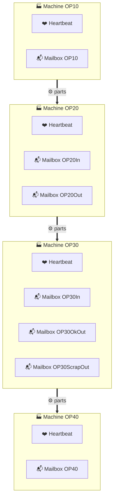
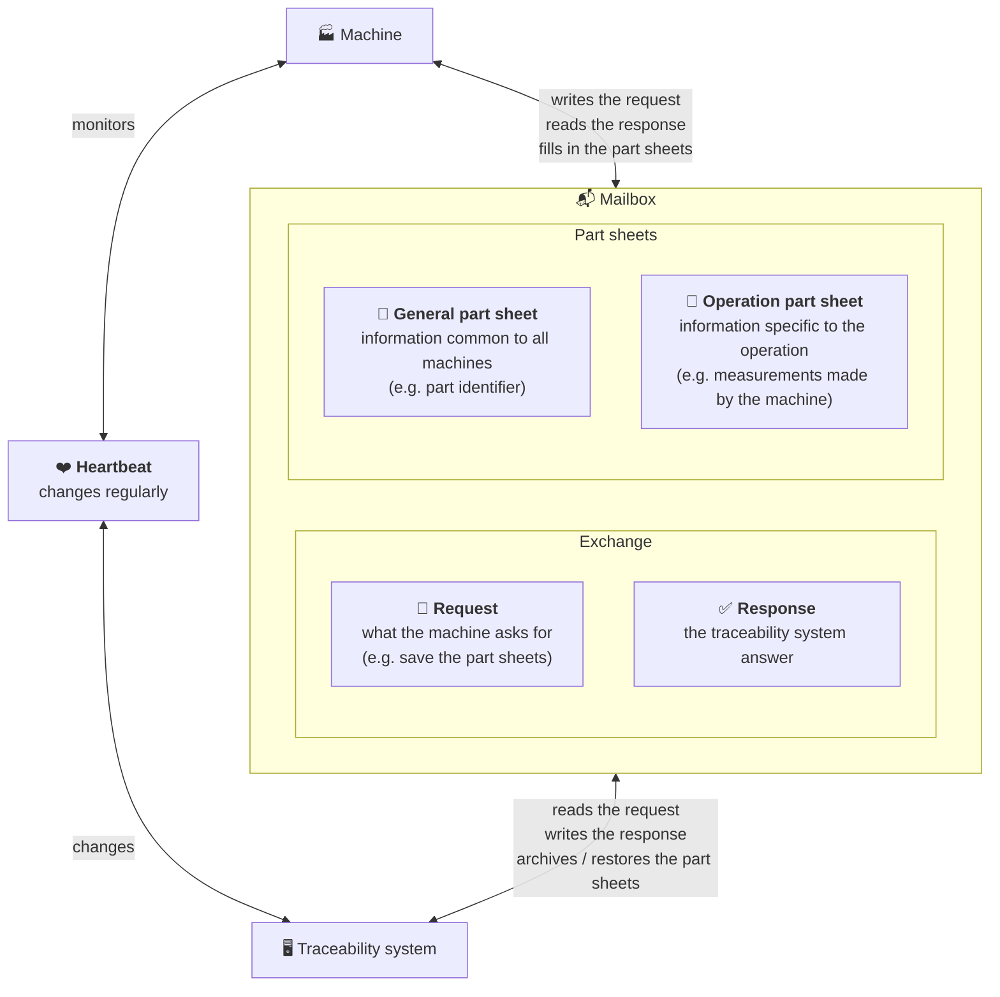
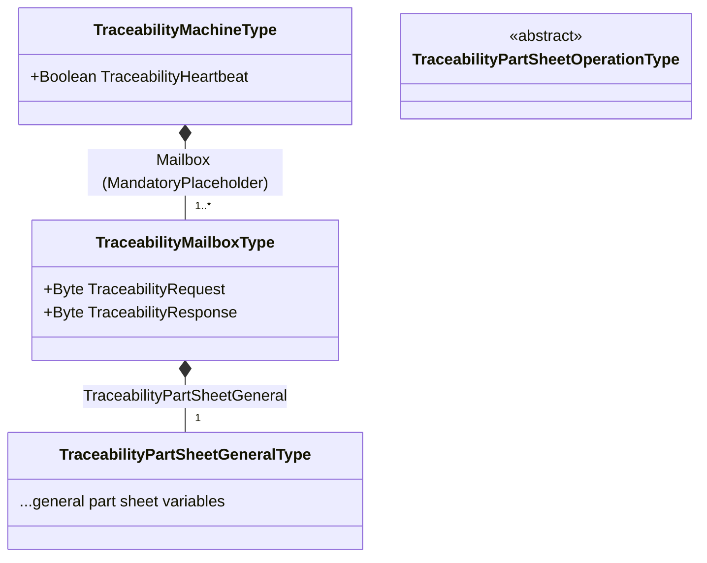
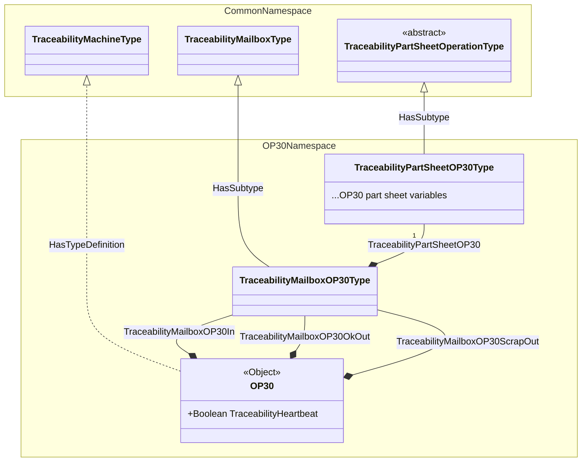

# Target OPC-UA information model

> [!NOTE]
> This model is not implemented yet, see the [TO-DO list](../TODO.md). The
> [README](../README.md) describes the model currently handled.

## Overview

Each machine exposes a heartbeat and one or more mailboxes. A mailbox holds the
traceability protocol variables (request and response codes) and a complete set
of part sheets: the general part sheet and the operation part sheet.

### Example for a production line

* Machine OP10
  * TraceabilityHeartbeat (boolean)
  * TraceabilityMailboxOP10 (object)
    * TraceabilityRequest (byte)
    * TraceabilityResponse (byte)
    * TraceabilityPartSheetGeneral (object)
      * ...general part sheet variables (mixed variable types)
    * TraceabilityPartSheetOP10
      * ...OP10 part sheet variables (mixed variable types)
* Machine OP20
  * TraceabilityHeartbeat (boolean)
  * TraceabilityMailboxOP20In (object)
    * TraceabilityRequest (byte)
    * TraceabilityResponse (byte)
    * TraceabilityPartSheetGeneral (object)
      * ...general part sheet variables (mixed variable types)
    * TraceabilityPartSheetOP20
      * ...OP20 part sheet variables (mixed variable types)
  * TraceabilityMailboxOP20Out (object)
    * TraceabilityRequest (byte)
    * TraceabilityResponse (byte)
    * TraceabilityPartSheetGeneral (object)
      * ...general part sheet variables (mixed variable types)
    * TraceabilityPartSheetOP20
      * ...OP20 part sheet variables (mixed variable types)
* Machine OP30
  * TraceabilityHeartbeat (boolean)
  * TraceabilityMailboxOP30In (object)
    * TraceabilityRequest (byte)
    * TraceabilityResponse (byte)
    * TraceabilityPartSheetGeneral (object)
      * ...general part sheet variables (mixed variable types)
    * TraceabilityPartSheetOP30
      * ...OP30 part sheet variables (mixed variable types)
  * TraceabilityMailboxOP30OkOut (object)
    * TraceabilityRequest (byte)
    * TraceabilityResponse (byte)
    * TraceabilityPartSheetGeneral (object)
      * ...general part sheet variables (mixed variable types)
    * TraceabilityPartSheetOP30
      * ...OP30 part sheet variables (mixed variable types)
  * TraceabilityMailboxOP30ScrapOut (object)
    * TraceabilityRequest (byte)
    * TraceabilityResponse (byte)
    * TraceabilityPartSheetGeneral (object)
      * ...general part sheet variables (mixed variable types)
    * TraceabilityPartSheetOP30
      * ...OP30 part sheet variables (mixed variable types)
* Machine OP40
  * TraceabilityHeartbeat (boolean)
  * TraceabilityMailboxOP40 (object)
    * TraceabilityRequest (byte)
    * TraceabilityResponse (byte)
    * TraceabilityPartSheetGeneral (object)
      * ...general part sheet variables (mixed variable types)
    * TraceabilityPartSheetOP40
      * ...OP40 part sheet variables (mixed variable types)

### Simplified view

Each machine of the line has one or more mailboxes to exchange part information
with the traceability system. Their number is chosen by the machine builder, and
is not necessarily related to the flow of parts: a machine can use a single
mailbox and perform data transfers internally at the right times, or use several
mailboxes, for instance one for each point where parts enter or leave it. Each
machine also has a heartbeat, showing that the traceability system is connected
and working:

All mailboxes are organized the same way: a request and a response, to exchange
with the traceability system, and two forms describing the part, the part
sheets. The traceability system archives the part sheets, and can restore the
general part sheet on a machine further down the line. Next to the mailboxes,
the traceability system regularly changes the heartbeat, which the machine
monitors to know that the traceability system is connected and working:

## Namespaces

The model is split in companion specifications, imported in the machines
controllers:

* A common namespace, imported on all machines, which only defines types (it has
no instances):
  * `TraceabilityPartSheetGeneralType`, with the general part sheet variables;
  * `TraceabilityPartSheetOperationType`, abstract and without variables, base of
  the operation part sheets types;
  * `TraceabilityMailboxType`, with:
    * `TraceabilityRequest` (`Byte`, read only);
    * `TraceabilityResponse` (`Byte`, read and write);
    * `TraceabilityPartSheetGeneral`, a mandatory component of
    `TraceabilityPartSheetGeneralType`;
  * `TraceabilityMachineType`, with:
    * `TraceabilityHeartbeat` (`Boolean`, read and write);
    * a `<Mailbox>` component of `TraceabilityMailboxType`, with the
    `MandatoryPlaceholder` modelling rule (i.e. one or more mailboxes, with any
    name).
* An operation namespace for each operation, imported on the machine performing
it, which defines (e.g. for OP30):
  * the operation part sheet type (`TraceabilityPartSheetOP30Type`), subtype of
  `TraceabilityPartSheetOperationType`, with the operation part sheet variables;
  * the mailbox type (`TraceabilityMailboxOP30Type`), subtype of
  `TraceabilityMailboxType`, adding the operation part sheet as a component
  (`TraceabilityPartSheetOP30`);
  * the machine instance (`OP30`), of `TraceabilityMachineType`, organized in the
  `Objects` folder, with its mailboxes as components of the operation mailbox type
  (e.g. `TraceabilityMailboxOP30In`).

The instances of the operation namespaces result in the tree shown in the
[example](#example-for-a-production-line).

All the variables of the model (heartbeat, request, response and part sheets
variables) are data variables, i.e. components (`HasComponent` references) of
`BaseDataVariableType`, rather than properties, as they hold the contents of their
parent object and not characteristics of it. The part sheets have no properties.

### Diagrams

Types of the common namespace:

Example of the OP30 operation namespace (names of operation-specific types are
illustrative), with the common namespace types it relies on:

Legend: links with a filled diamond are `HasComponent` references (labelled with
the BrowseName of the child, the diamond being on the parent side), links with a
hollow triangle are `HasSubtype` references (the triangle pointing to the
supertype), dashed links are `HasTypeDefinition` references.

## Design rationale

### Import in the machines controllers

* A controller (e.g. S7-1500 with TIA Portal) imports a companion specification
as a whole, and the variables of its instances are mapped to the controller
variables. As each machine only imports the common namespace and the namespace
of its operation, it has no instances of other machines to map.
* Controllers can only map the variables of existing instances, they do not
instantiate types. Instances are thus fully expanded in the operation namespaces
nodesets, with all their children.
* When several machines perform the same operation:
  * if they are identical (same object name, same mailboxes), the same operation
  namespace is imported on each of them, each OPC-UA server exposing its own
  instance;
  * otherwise, the operation namespace only defines the types, and each machine
  has an additional namespace, depending on it, which defines its instance. The
  types must not be duplicated in each machine namespace, as types from
  different namespaces are different types.

### BrowseNames

* The children of an instance take the BrowseNames of the type children they are
created from, including the namespace of the type defining them. The request, the
response, the general part sheet and its variables thus have BrowseNames in the
common namespace, identical on all machines, whatever the namespace of the
machine instance. This is what allows resolving nodes by BrowseName.
* The operation part sheet is found by its type rather than by its BrowseName,
which can then be specific to each operation (e.g. `TraceabilityPartSheetOP30`).

### Node identifiers stability

Node identifiers are assigned when generating the nodesets. The generator keeps
the identifiers of the previous generation, so that adding a variable does not
renumber the other nodes: the mappings of the controllers variables remain valid
when importing an updated nodeset. The gateway does not depend on these
identifiers anyway (see below).

## Nodes resolution

Node identifiers of the general part sheet differ between mailboxes and machines,
so they are not used as references. Instead:

* Mailboxes are discovered by browsing the machine object, and the operation part
sheet is found by its type, as their BrowseNames are not known beforehand;
* Nodes with BrowseNames defined by the common namespace types (the heartbeat in
the machine object, the request, the response and the general part sheet in each
mailbox) are resolved with the `TranslateBrowsePathsToNodeIds` service, in a
single request for all the mailboxes of a machine. A missing node gives a
specific error for its path (`BadNoMatch`), revealing an unexpected model;
* The variables of the part sheets are discovered by browsing the part sheets
objects, as all of them are needed;
* At session initialization, a `BrowseName → NodeId` table is built for each mailbox,
then OPC-UA reads and writes keep using numeric node identifiers;
* Cached general part sheet items are keyed by BrowseName (name part only), which
is identical on all machines as defined by the common namespace types.

Summary of the OPC-UA service used for each kind of node:

| Nodes to find | BrowseName known beforehand | Service |
| --- | --- | --- |
| Mailboxes of a machine | No (`<Mailbox>` placeholder) | `Browse`, filtering on the type |
| Operation part sheet of a mailbox | No (specific to each operation) | `Browse`, filtering on the type |
| Variables of the part sheets | All of them are needed, not a fixed list | `Browse` |
| Request, response and general part sheet of a mailbox | Yes, in the common namespace | `TranslateBrowsePathsToNodeIds` |
| Heartbeat of a machine | Yes, in the common namespace | `TranslateBrowsePathsToNodeIds` |

The browse paths text format ([OPC-UA Part 4, Annex A][relative-path-bnf]) does
not allow resolving all nodes with `TranslateBrowsePathsToNodeIds`: only the last
element of a path can have no BrowseName (matching all targets), and the results
only hold node identifiers, without BrowseNames nor types.

### Resolution sequence

Both services take an array of starting nodes (or of browse paths, each with its
own starting node), and return the results in the same order. The nodes of a
machine are thus resolved with a few requests, whatever the number of mailboxes:

1. `Browse` of the machine object, to discover the mailboxes and their types;
2. `TranslateBrowsePathsToNodeIds` of all the paths with BrowseNames known
beforehand, starting from the machine object or from the mailboxes discovered at
the previous step;
3. `Browse` of all the part sheets (general part sheets found at the previous
step, operation part sheets found at the first step), to list their variables.

For example, with the three mailboxes of OP30, the second step is a single request
with ten browse paths, the result at a given position matching the path at the
same position:

| # | Starting node | Relative path |
| --- | --- | --- |
| 1 | `OP30` | `<HasComponent><common>:TraceabilityHeartbeat` |
| 2 | `TraceabilityMailboxOP30In` | `<HasComponent><common>:TraceabilityRequest` |
| 3 | `TraceabilityMailboxOP30In` | `<HasComponent><common>:TraceabilityResponse` |
| 4 | `TraceabilityMailboxOP30In` | `<HasComponent><common>:TraceabilityPartSheetGeneral` |
| 5–7 | `TraceabilityMailboxOP30OkOut` | the same three paths |
| 8–10 | `TraceabilityMailboxOP30ScrapOut` | the same three paths |

Where `<common>` is the index of the common namespace on the server.

Points to consider:

* As all the children are components, both the browse paths and the browsing
follow `HasComponent` references (subtypes included), matching the model exactly:
a node modelled differently (e.g. as a property) is not found, revealing an
unexpected model. The part sheets variables are found by browsing `HasComponent`
references to nodes of `Variable` class;
* Servers may limit the number of nodes or paths per request (`OperationLimits`
of the server capabilities, e.g. `MaxNodesPerBrowse` and
`MaxNodesPerTranslateBrowsePathsToNodeIds`). The limits of the controllers are
not known yet: they can be read when connecting, or the requests split when
rejected.

[relative-path-bnf]: https://reference.opcfoundation.org/specs/OPC-10000-4
